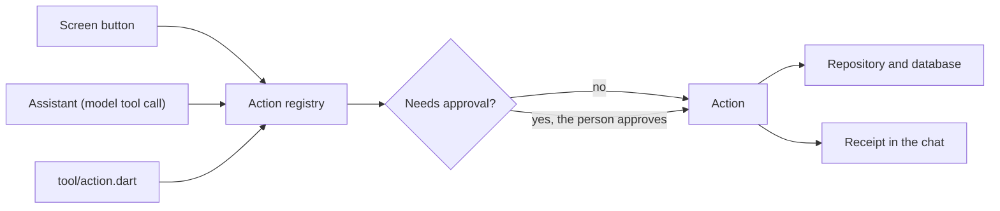
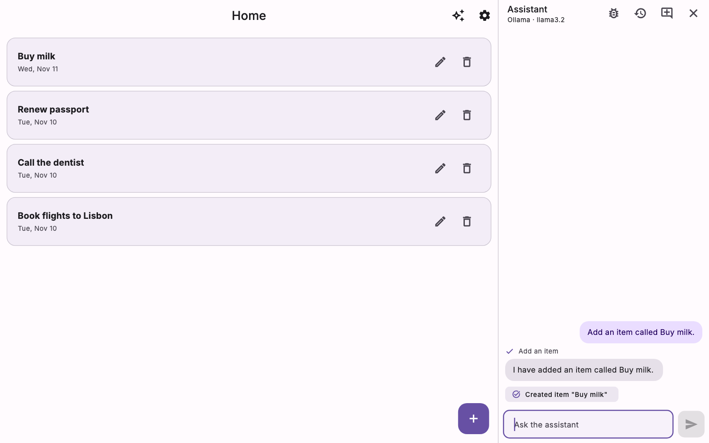
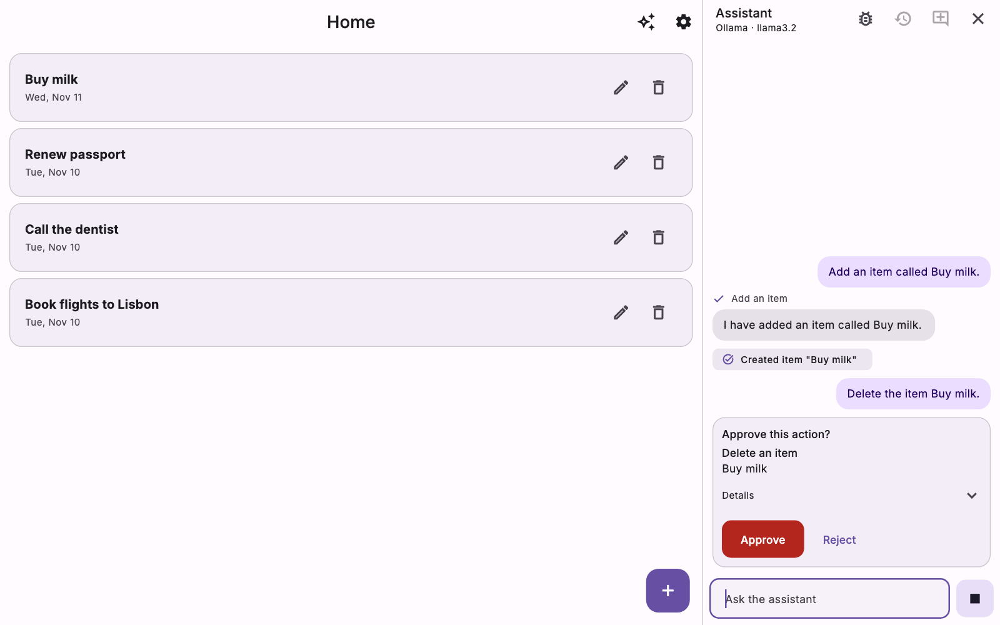
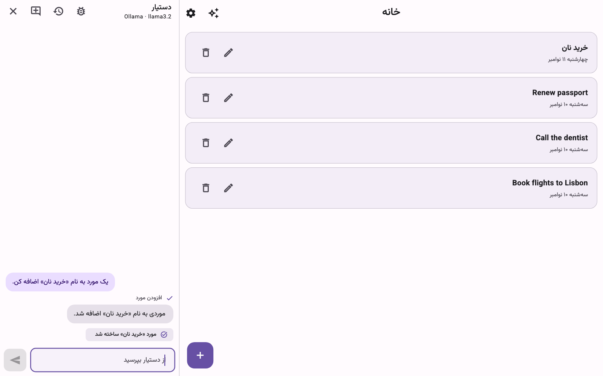
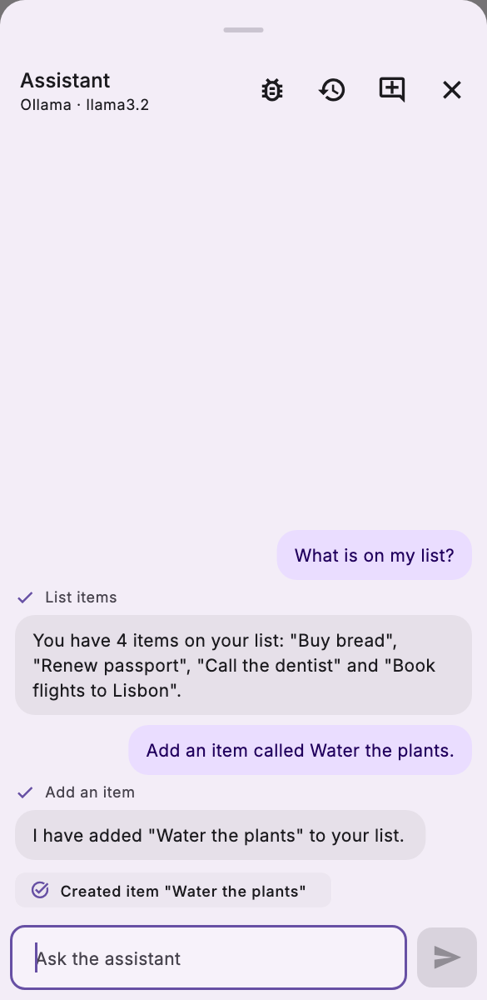

# Flutter Agentify

**A Flutter app template where the in-app AI assistant uses the same actions as your UI.**

[](https://github.com/aazirani/flutter_agentify/actions/workflows/flutter-ci.yml)
[](https://flutter.dev)
[](https://dart.dev)
[](LICENSE)


Every change in a Flutter Agentify app is an **action**: one Dart class with a typed input and a test. A button, the assistant (through tool calling) and the command line all run it through the same registry. The assistant can do what the UI can do, asks before anything risky, and leaves a receipt for every change. The template also ships the rules, skills and checks a coding agent needs to build on it.

[Quick start](#quick-start) · [How it works](#how-it-works) · [Documentation](docs/README.md)

## Quick start

You need Flutter 3.47+.

```bash
git clone --depth 1 https://github.com/aazirani/flutter_agentify.git notes_app
cd notes_app
dart tool/setup.dart --name notes_app --org com.acme --starter empty
git add -A && git commit -m "Set up notes_app"
flutter pub get && dart run build_runner build && flutter run
```

Then give the assistant a model, either way:

- **A model server** (the default). Run [Ollama](https://ollama.com) with `ollama pull qwen3:8b`, open Settings in the app and enter `qwen3:8b` as the model. Hosted APIs work the same way, with a key.
- **A model inside the app.** Add `--model on-device` to the setup line. The first time the assistant opens, it offers to download Gemma 4 E2B (about 2.6 GB); after that it needs no server and no key. It runs on macOS 14 on Apple Silicon, Android 11 (arm64), iOS 15, Windows (x64) and Linux. On web it is off unless you turn it on in `lib/ai/assistant_setup.dart`, and the web runtime is a preview. [Choose where the model runs](docs/guides/choose-where-the-model-runs.md)

Then ask the assistant to `Switch to dark mode.` [Getting started](docs/getting-started.md) covers every step, with phones, web and Windows.

### Or ask your coding agent

```text
Create a new app with Flutter Agentify. Get the template with
`gh repo create <name> --template aazirani/flutter_agentify --private --clone`
(or `git clone --depth 1 https://github.com/aazirani/flutter_agentify.git <name>`),
read AGENTS.md in it and follow it from the top. The app I want: <describe the app>.
```

The agent sets the project up, builds each feature with its action, test and screen, and stops when `tool/check.sh` passes. See [Build with a coding agent](docs/tutorial/build-with-a-coding-agent.md).

## Why

Most in-app assistants can only talk about the app. The ones that can act usually reach the data through a side door, with their own calls and their own idea of what is allowed, and drift away from the screens.

Flutter Agentify gives both the same door. You write an action once; the screen, the model and `tool/action.dart` all call it, and one test covers all three.

## How it works



An action declares its name, a description for the model, an input schema and what it changes. This is `set_theme_mode` from [`lib/domain/actions/settings_actions.dart`](lib/domain/actions/settings_actions.dart), trimmed:

```dart
class SetThemeMode extends AgentAction<AppThemeMode, AppThemeMode> {
  @override
  String get name => 'set_theme_mode';

  @override
  String get description =>
      'Switches the app between light and dark, or follows the system.';

  @override
  late final ObjectSchema<AppThemeMode> input = S.object(
    fields: {
      'mode': S.string(
        description: 'system, light or dark.',
        oneOf: [for (final mode in AppThemeMode.values) mode.name],
      ),
    },
    build: (v) => AppThemeMode.values.byName(v['mode'] as String),
  );

  @override
  Future<AppThemeMode> run(AppThemeMode input, ActionContext context) async {
    await settings.setThemeMode(input);
    context.receipt(
      resource: 'settings',
      ids: const ['theme_mode'],
      summary: 'Theme set to ${input.name}',
      verified: settings.getThemeMode() == input,
    );
    return input;
  }
}
```

The Settings screen calls `registry.run(actions.setThemeMode, mode)`; the assistant gets the same action as a tool. A lint rule keeps screens from changing data any other way. See [Overview](docs/concepts/overview.md).

## What's included

- **Shared actions.** One registry for the UI, the assistant and the command line. [Actions](docs/concepts/actions.md)
- **Approval and receipts.** Risky actions wait for the person; every change shows what really happened. [Approval and receipts](docs/concepts/approval-and-receipts.md)
- **App context.** The assistant knows the current screen, so "delete the second one" works. [App context](docs/concepts/app-context.md)
- **Any model.** Ollama and other local servers, OpenAI-compatible APIs, Anthropic, your own proxy, or Gemma running inside the app with no server. [Choose where the model runs](docs/guides/choose-where-the-model-runs.md)
- **Architecture that stays clean.** Layered app with Riverpod, drift and go_router, custom lint rules, and one gate, `tool/check.sh`. [Architecture](docs/concepts/architecture.md)
- **Built for coding agents.** `AGENTS.md`, a skill per topic, and a doctor that checks them. [Coding agents](docs/concepts/coding-agents.md)
- **Any language, left to right or right to left.** English and Persian ship as examples. [Add a language](docs/guides/add-a-language.md)
- **Setup and upgrade.** `tool/setup.dart` names a project and picks a starting point; `tool/upgrade.dart` brings in the newest framework. [Choose a starting point](docs/guides/choose-a-starting-point.md)

## Screenshots

| Tool call with a receipt | Approval before a delete |
|---|---|
|  |  |
| **Persian, right to left** | **Phone width** |
|  |  |

## Documentation

Start with [Getting started](docs/getting-started.md) and [Build your first feature](docs/tutorial/build-your-first-feature.md). Everything else is in the [docs index](docs/README.md) and the [reference](docs/reference/README.md).

## Platforms

macOS is built and run, and web is built. iOS and Android are built and run on a device (an iPhone 13 Pro Max and a Redmi A5), where the in-app model was measured. Linux and Windows are built in CI but not yet run; reports are welcome. See [Platforms](docs/guides/platforms.md).

## Packages

The app uses these by path from `packages/`; they are not on pub.dev.

| Package | What it is |
|---|---|
| [`flutter_agentify_core`](packages/flutter_agentify_core/) | Actions, the agent loop, model providers, the doctor and the CLI. Pure Dart. |
| [`flutter_agentify_ui`](packages/flutter_agentify_ui/) | The chat widget, approval cards and receipt chips. |
| [`flutter_agentify_lints`](packages/flutter_agentify_lints/) | Analyzer rules that keep the architecture intact. |
| [`flutter_agentify_on_device`](packages/flutter_agentify_on_device/) | The model inside the app (Gemma 4 E2B on LiteRT-LM). Only with `--model both` or `on-device`. |

## Contributing

See [CONTRIBUTING.md](CONTRIBUTING.md) and the [Code of Conduct](CODE_OF_CONDUCT.md). Changes are in the [changelog](CHANGELOG.md). To report a vulnerability, follow [SECURITY.md](SECURITY.md).

## License

[MIT](LICENSE). The bundled fonts Inter and Vazirmatn are under the SIL Open Font License 1.1; see [`assets/fonts/`](assets/fonts/).
