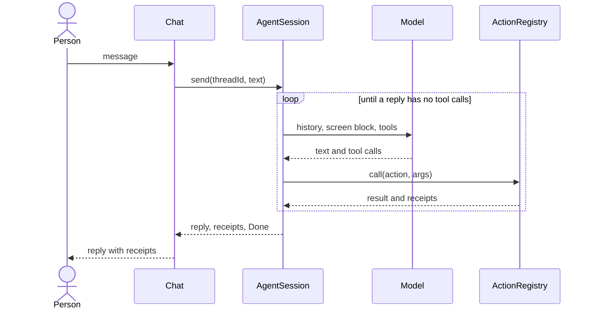

# Agent loop

The agent loop is what happens between the person's message and the assistant's reply. `AgentSession` runs it.

## What happens

1. The session sends the message, the `<current-screen>` block and the tools to the model.
2. The model replies with text, tool calls, or both.
3. The session runs each tool call as an action, through the registry. An action that needs approval waits for the person.
4. The session sends the results back to the model.
5. Steps 2 to 4 repeat until the model replies without tool calls.



## Why

The loop lets the model take several steps for one request, such as "find the old items and delete them". The session also keeps the model in bounds. A run stops at a step limit, a token budget, or when the model repeats the same call. A failing tool call does not end the run: the model gets the error and can correct itself.

## In the app

The app builds one session for whichever model answers (a model server, or the model inside the app), from [`lib/ai/assistant_providers.dart`](../../lib/ai/assistant_providers.dart):

```dart
AgentSession _session(LlmProvider provider, ModelConfig model) => AgentSession(
  registry: _getIt<ActionRegistry>(),
  appContext: _getIt<AppContext>(),
  provider: provider,
  model: model,
  threads: _getIt<ThreadStore>(),
  memories: _getIt<MemoryStore>(),
  appInstructions: _getIt<AssistantInstructions>().text,
  approvals: _getIt<ApprovalPrefs>(),
);
```

The registry is the same one the screens use. `appInstructions` comes from `assets/assistant/instructions.md`.

## Reference

[Agent loop](../../packages/flutter_agentify_core/doc/agent-loop.md): the events, the stop limits and their defaults, and what changes for small models.
