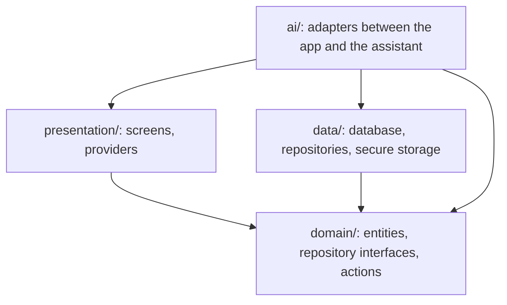

# Architecture

The app in `lib/` has four layers. Each layer has one job and may import only some of the others.



An arrow means "may import". `domain/` imports none of the other layers and no Flutter.

## Why

The rules keep the parts apart. Actions in `domain/` run without Flutter, so the command line and plain Dart tests can run them. Screens never reach the database, so every change goes through an action and the assistant can make it too. Lint rules check the imports, so a wrong import fails the gate.

## Where code goes

```
lib/
├── domain/          entities, repository interfaces, actions (pure Dart)
├── data/            drift database, repositories, preferences, secure storage
├── presentation/    screens, Riverpod providers, the assistant shell
├── ai/              screen table, router and change-event adapters, assistant providers
├── core/            theme and shared widgets
├── di/              service locator
└── utils/           routes, localization
```

- A new thing the app can do is an action in `lib/domain/actions/`.
- A new kind of data is an entity in `lib/domain/entities/`, a repository interface in `lib/domain/repositories/`, and its drift version in `lib/data/`.
- A new screen goes in `lib/presentation/`, with a route and an entry in `lib/ai/screen_contexts.dart`.

## How the layers are joined

The service locator registers each layer in order, from [`lib/di/service_locator.dart`](../../lib/di/service_locator.dart):

```dart
  /// Registers the data, domain and assistant layers. [container] is the
  /// app's provider container, so the assistant's adapters can reach it.
  static Future<void> configure(ProviderContainer container) async {
    await DataLayerInjection.configureDataLayerInjection();
    await DomainLayerInjection.configureDomainLayerInjection(
      getIt,
      serverEditable:
          assistantSetup.usesServer && assistantSetup.server.userEditable,
      onDeviceModel: () => container.read(onDeviceModelProvider),
      deviceOptional: assistantSetup.mode == ModelMode.both,
    );
    await configureAi(container);
  }
```

The `onDeviceModel:` and `deviceOptional:` lines are there only in a project with the model inside the app.

## Reference

[Quality gate](quality-gate.md): the checks that hold these rules.
