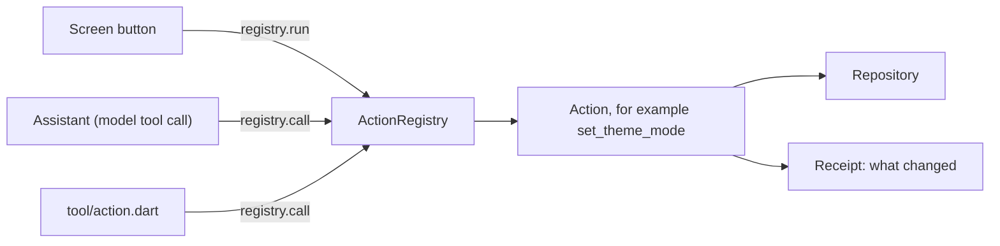

# Overview

A Flutter Agentify app has an assistant inside it. The assistant can do what the person can do with the buttons, because both use the same code.

That code is an **action**. An action is one thing the app can do, such as "switch to dark mode" or "delete an item". It is written once. Three callers use it:

- **The UI.** A button calls the action through the registry.
- **The assistant.** The model asks for the action by name, as a tool call.
- **The command line.** `tool/action.dart` runs the action without Flutter.



## Why

If the assistant had its own code path, it would drift away from the UI. A fix in one place would not reach the other. With one action, a test of the action covers all three callers.

## One action

This is the action behind the theme switch, from [`lib/domain/actions/settings_actions.dart`](../../lib/domain/actions/settings_actions.dart):

```dart
/// `set_theme_mode`: light, dark or the system's choice.
class SetThemeMode extends AgentAction<AppThemeMode, AppThemeMode> {
  SetThemeMode(this.settings);

  final SettingsRepository settings;

  @override
  String get name => 'set_theme_mode';

  @override
  String get description =>
      'Switches the app between light and dark, or follows the system.';

  @override
  late final ObjectSchema<AppThemeMode> input = S.object(
    fields: {
      'mode': S.string(
        description: 'system, light or dark.',
        oneOf: [for (final mode in AppThemeMode.values) mode.name],
      ),
    },
    build: (v) => AppThemeMode.values.byName(v['mode'] as String),
  );
```

The settings screen calls it with typed input. The assistant and the command line call it with JSON. Run it from a terminal:

```bash
dart run tool/action.dart set_theme_mode '{"mode":"dark"}'
```

It prints the result and a receipt: `receipt: Theme set to dark`.

## Next

- [Actions](actions.md): how to write one.
- [App context](app-context.md): what the assistant sees.
- [Agent loop](agent-loop.md): how the assistant decides which action to call.
