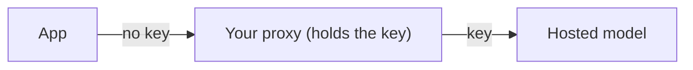

# Ship without user keys

A model inside the app needs no key at all; see [Choose where the model runs](choose-where-the-model-runs.md). A hosted model needs a key. You cannot put your key in the app: anyone can pull it out of the app file. On web the app stores no key at all. The answer is a server you run, a proxy, that holds the key. The app talks to the proxy; the proxy talks to the model.



## What the proxy must do

The app sends the OpenAI-compatible format, so the proxy accepts that and forwards it:

1. Accept `POST <address>/chat/completions` with `messages`, optional `tools` and `stream: true`.
2. Add the key on the server and forward the request to the model.
3. Stream the reply back as server-sent events, without buffering, and end with `data: [DONE]`. A proxy that buffers makes the chat look frozen.
4. Limit use per person: a sign-in or a per-device token, a request rate and a token cap. The address is public once the app ships, so anyone who finds it can spend your money.
5. For web, send CORS headers for the app's address and answer `OPTIONS` requests.
6. Pass errors through with their real status, such as 429 or 503, so the app can retry the right ones.

The `backend-proxy` skill in `.agents/skills/backend-proxy/SKILL.md` has the same list for a coding agent, and names the client code to read for the exact fields.

Test the proxy before you test the app. `-N` shows the stream as it arrives:

```bash
curl -N https://ai.example.com/v1/chat/completions \
  -H "content-type: application/json" \
  -d '{"model":"<model>","stream":true,"messages":[{"role":"user","content":"Hi"}]}'
```

## Point the app at it

The Custom preset is for this. Its key is optional.

1. In Settings, under Assistant, choose "Custom (OpenAI-compatible)".
2. Set the server address to the proxy's `/v1` root, for example `https://ai.example.com/v1`. Use `https://` for anything outside your network.
3. Type a model name the proxy accepts.
4. Leave the API key empty; the proxy adds its own. Or type a per-person token the proxy checks (not on web).
5. Under Advanced, set whether the model can call tools.

## Ship it already pointing there

So people do not have to type the address, set the server in `lib/ai/assistant_setup.dart`:

```dart
const assistantSetup = AssistantSetup(
  mode: ModelMode.server,
  server: ServerSetup(
    presetId: 'custom',
    baseUrl: 'https://ai.example.com/v1',
    model: '<model>',
    userEditable: false,
  ),
);
```

With `userEditable: false` Settings has no server section and the actions that change the server are not registered, so these values are final. Leave it `true` to let people change them. See [Choose where the model runs](choose-where-the-model-runs.md#stop-people-changing-the-server-model).

Never put a key there. The lint rule `no_secret_literals` and the doctor's `bundled-secrets` check fail the gate on key-shaped text:

```bash
tool/check.sh
```

See [Model providers](../../packages/flutter_agentify_core/doc/model-providers.md) for the Custom preset and the rules on keys.
